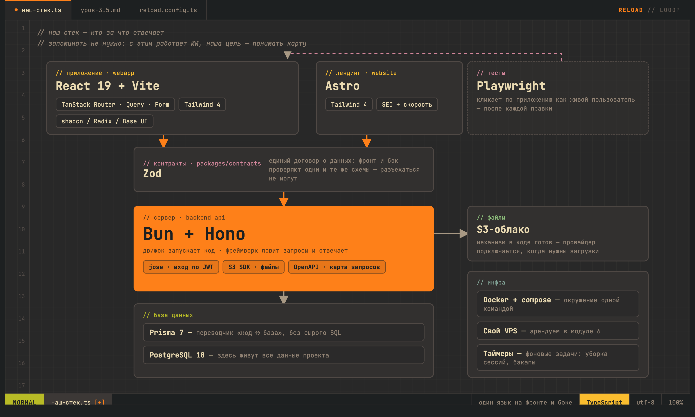

# Серийка

<p align="center">
  
</p>

«Серийка» — публичный каталог серийной мебели. В первой версии посетитель сможет выбрать решение, настроить его в конфигураторе и отправить заявку. Личные кабинеты, онлайн-оплата, загрузка файлов и обновления в реальном времени пока не входят в продукт.

## Первая версия

- Публичный сайт с каталогом серийной мебели, конфигуратором и формой заявки.
- Без личных кабинетов для клиентов и сотрудников: они появятся позже.
- Без оплаты, загрузки файлов и функций реального времени.
- Продакшен-адрес: `seriya.raspilok.ru`.
- Развёртывание планируется на уже арендованном VPS; настройка сервера, HTTPS и резервных копий начнётся, когда будут предоставлены данные доступа.

## Что уже работает из коробки

- **Вход и регистрация** с защитой сессий серьёзного уровня: безопасные куки, ротация токенов, защита от кражи ключа сессии, работа в нескольких вкладках без конфликтов.
- **База данных** (PostgreSQL) с миграциями — структура меняется безопасно, без ручного SQL.
- **Кабинет** (React) — экраны твоего продукта за логином.
- **Публичный сайт** (Astro) — заготовка для лендинга и SEO-страниц.
- **Общие контракты** — сервер и кабинет говорят на одном языке, расхождения ловятся автоматически.
- **Тесты и автоматическая проверка архитектуры** — ИИ не сможет превратить код в спагетти: проверка границ модулей ломает сборку при нарушении.
- **Система работы с ИИ** — план → план-ревью → код → код-ревью, с встроенными навыками ревью (см. ниже).
- **Инструкция «сервер под ключ»** — от голого арендованного сервера до работающего сайта с HTTPS и ночными бэкапами.

## Что понадобится

- **Claude Code** — твой ИИ-инженер (правила для него уже лежат в этом репозитории: `CLAUDE.md` / `AGENTS.md`).
- **Docker** — в нём живёт локальная база данных. Если не установлен, ИИ подскажет, как поставить.
- **Аккаунт GitHub** — там будет жить твой приватный репозиторий.

Всё остальное (Bun, зависимости, базу) ИИ установит и настроит сам.

## Первый запуск

1. Склонируй этот репозиторий в папку своего проекта.
2. Открой в этой папке Claude Code и вставь один промпт:

```text
Прочитай README.md, CLAUDE.md и docs/*.md этого шаблона. Это новый проект из шаблона — выполни Bootstrap-Only Instructions из CLAUDE.md. Проведи со мной интервью первого запуска простым языком: название проекта, что строим первым, какие поверхности нужны сейчас (кабинет, публичный сайт, сервер), нужны ли в первой версии оплаты, загрузка файлов, реальное время, есть ли уже арендованный сервер и домен. Затем: отвяжи репозиторий от шаблона, настрой локальную базу через Docker Compose, создай .env из .env.example (сначала проверь, что git эти файлы не видит), переименуй проект, запусти всё локально и покажи адреса. Мой приватный репозиторий на GitHub создай, когда я попрошу. Если я дам доступы к серверу (IP, логин, пароль) — разверни всё под ключ по docs/DEPLOYMENT.md: сначала защита сервера, потом попроси меня зарегистрировать домен, настрой HTTPS, деплой одной командой и ночные бэкапы. После завершения настройки удали Bootstrap-блоки из CLAUDE.md и AGENTS.md.
```

3. Отвечай на вопросы ИИ — дальше он всё сделает сам и покажет, где открыть проект в браузере.

## Как мы работаем: система курса

Каждую задачу ИИ начинает с оценки сложности — и говорит её вслух:

- **Сложная задача** (новая фича, оплаты, права доступа, изменение поведения) → ИИ предлагает: «задача сложная, предлагаю сначала план». Согласишься — план сохраняется в папку `PLANS/` и проходит **`/loop-plan-review`**: независимый проверяющий крутит раунды замечаний, пока план не станет готовым к исполнению.
- **Простая задача** → ИИ говорит «это просто, делаю сразу» и делает.
- **После сложного кода** → ИИ предлагает **`/loop-code-review`**: независимый ревьюер ищет ошибки и уязвимости кругами, пока не поставит минимум 9,5 из 10 или не скажет «замечаний нет».
- **Решение всегда за тобой** — ИИ обязан предложить план и ревью, но не вправе навязать.

Оба навыка уже встроены в репозиторий (папка `.claude/skills/`) — команды `/loop-plan-review` и `/loop-code-review` работают сразу после клонирования, ставить ничего не нужно.

## Свой сервер

Проект живёт на собственном арендованном VPS — никаких облачных платформ и подписок на сервисы деплоя. Когда арендуешь сервер, просто дай ИИ три вещи: IP-адрес, логин, пароль. Дальше он сам:

1. Закроет сервер (вход только по ключам, защитная стена, автобан переборщиков паролей).
2. Поставит всё окружение и развернёт проект.
3. Попросит тебя зарегистрировать домен и объяснит, что нажать у регистратора.
4. Настроит HTTPS с автопродлением сертификата.
5. Настроит деплой одной командой и ночные резервные копии базы.

Пароль сервера при этом **нигде не сохраняется** — он нужен один раз, потом вход по паролю отключается навсегда. Подробный сценарий: [docs/DEPLOYMENT.md](docs/DEPLOYMENT.md).

## Секреты

Любые ключи и пароли (платёжки, боты, доступы) живут только в файлах `.env`, которые git не видит в принципе, — в код и на GitHub они не попадают никогда. В репозитории лежат только файлы-оглавления `.env.example` с пустышками. Это правило зашито в `CLAUDE.md`, ИИ следит за ним сам.

## Что внутри

- `backend/` — сервер: Bun + Hono + Prisma + PostgreSQL, авторизация, проверка данных.
- `webapp/` — кабинет: React + Vite + TanStack, готовая библиотека интерфейсных компонентов.
- `website/` — публичный сайт на Astro (лендинг, SEO-страницы).
- `packages/contracts/` — общие схемы данных сервера и клиента.
- `PLANS/` — планы фич по шаблону из [PLANS/README.md](PLANS/README.md).
- `docs/` — инструкции: деплой, хранилище файлов, тесты, локальная база, архитектура.
- `scripts/vps/` — готовые файлы для сервера: деплой-скрипт, службы, таймеры, бэкап.
- `.claude/skills/` — встроенные навыки `/loop-plan-review` и `/loop-code-review`.

Куда класть страницы: публичные, индексируемые поисковиками (лендинг, статьи, каталог) — в `website`; экраны за логином без SEO — в `webapp`. ИИ знает это правило и решит за тебя.

## Полезные команды

```bash
bun run dev          # запустить всё локально (сервер + кабинет + сайт)
bun run test         # все тесты
bun run typecheck    # проверка типов
bun run architecture:check   # проверка границ модулей
bun run e2e:webapp   # сквозные браузерные тесты
```

## Рекомендуем: статус-лайн

Поставь [claude-code-statusline](https://github.com/tablesguru/claude-code-statusline) — строку статуса для Claude Code от автора курса. Она показывает модель, расход контекста, лимиты — и **живые оценки раундов ревью**: пока крутится `/loop-code-review`, баллы каждого раунда видны прямо в статусной строке. Ставится одной командой из README проекта.

## Благодарности и лицензия

Основа этого репозитория — [Vibe Coding Template](https://github.com/di-sukharev/vibe) Димы Сухарева (лицензия Apache-2.0; файлы `LICENSE` и `NOTICE` с авторством сохранены, спасибо автору за отличный фундамент). Адаптация для курса «Перезагрузка»: развёртывание на собственном VPS вместо облачных платформ, сценарий «сервер под ключ», цикл «план → план-ревью → код → код-ревью», встроенные навыки ревью и папка планов.
